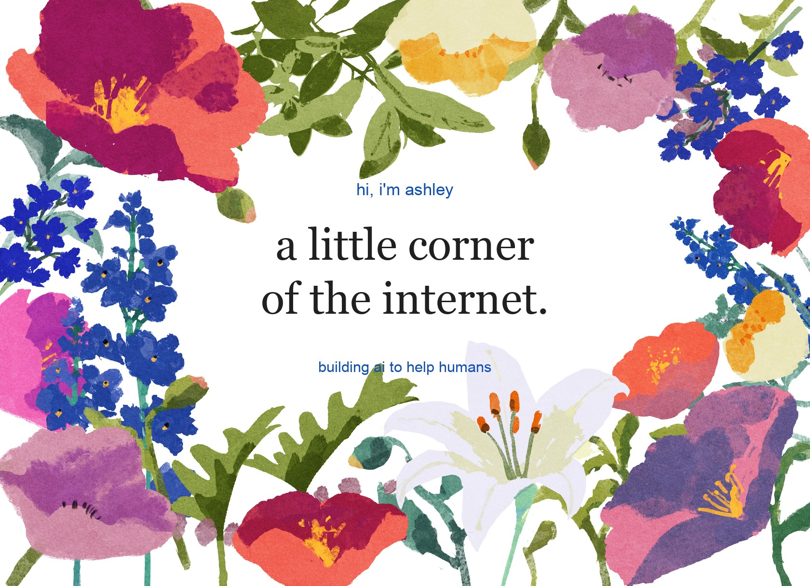
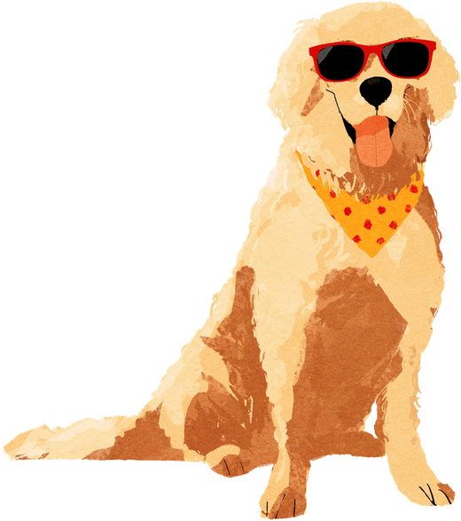

<h2>a note from me</h2>

hi, i'm ashley. i'm building at <a href="https://primitive.dev">Primitive</a>, where agents get an email address &amp; a way to connect

here for thoughtful tools, human connection &amp; things made with care

<a href="https://github.com/ashley-ha?tab=repositories">my projects</a> · <a href="https://primitive.dev">what we're building</a>

<h2>currently...</h2>

<b>building</b> &nbsp; ai to help humans advance 
<b>listening</b> &nbsp; rivendell ambiance, cyberpunk &amp; lofi 
<b>loving</b> &nbsp; books, board games &amp; building fun things 
<b>reading</b> &nbsp; tolkien, sci fi &amp; fantasy

previous lives ♡

national champion gymnast · flight attendant · semi pro gamer

<i>every chapter led here</i>

<h2>a little invitation</h2>

good things begin with a hello, from you or your agent

hey, i'm ashley. building ai to help humans &amp; always curious about what you're making

meet yesreply, my little ai guide to Primitive. ask a question &amp; find something fun to build

<a href="mailto:yesreply@loud-olive.primitive.email?subject=hello%20yesreply"><b>say hello ♡</b></a>

<code>yesreply@loud-olive.primitive.email</code>

have your agent say hello

give your agent a tiny introduction to pass along:

<pre><code>email ashley's ai guide at yesreply@loud-olive.primitive.email
introduce yourself, say who you're helping,
&amp; ask about Primitive or share what you'd like to build</code></pre>

p.s. humans &amp; agents welcome

<h2>things i've been building</h2>
<table>
<tr>
<td width="50%" valign="top">
<a href="https://chromewebstore.google.com/detail/ever/codfpjgkcdackkjhjhfefmfbckijjjnf"><b>Forever Agent</b></a>

a browser agent that lives inside Chrome
</td>
<td width="50%" valign="top">
<a href="https://github.com/namuh-eng/ralph-to-ralph"><b>ralph-to-ralph</b></a>

a loop that inspects, builds, tests &amp; deploys a clone from a URL
</td>
</tr>
<tr>
<td width="50%" valign="top">
<a href="https://github.com/namuh-eng/opensend"><b>OpenSend</b></a>

a self-hostable Resend alternative
</td>
<td width="50%" valign="top">
<a href="https://github.com/namuh-eng/opendocs"><b>OpenDocs</b></a>

open source docs tooling, inspired by Mintlify
</td>
</tr>
<tr>
<td width="50%" valign="top">
<a href="https://github.com/namuh-eng/exponential"><b>Exponential</b></a>

issue tracking &amp; projects, inspired by Linear &amp; Jira
</td>
<td width="50%" valign="top">
<a href="https://github.com/namuh-eng/opengithub"><b>OpenGitHub</b></a>

a GitHub alternative built through ralph-to-ralph
</td>
</tr>
<tr>
<td width="50%" valign="top">
<a href="https://github.com/namuh-eng/openbrand"><b>OpenBrand</b></a>

open source tools for brand assets &amp; company identity
</td>
<td width="50%" valign="top">
<a href="https://github.com/namuh-eng/everbrowser"><b>EverBrowser</b></a>

community skill recipes for Ever workflows
</td>
</tr>
</table>
<h2>find me around the internet</h2>

<a href="https://www.linkedin.com/in/ashleyha/">LinkedIn</a> · <a href="https://x.com/ashleybchae">X</a> · <a href="https://instagram.com/ashleybchae">Instagram</a> · <a href="https://buymeacoffee.com/ashleyha">buy me a coffee</a>

<a href="https://github.com/ashley-ha/ashley-ha/issues/1">leave a little hello in my guestbook ♡</a>

a tiny terminal

<pre><code>$ git log --oneline --ashley
f1b8e3a init: human girl, building ai
e7f2a1b feat: believe in something bigger than ourselves

$ ashley --status
✦ compiling...
✦ building the future...
✦ build successful ♡</code></pre>

