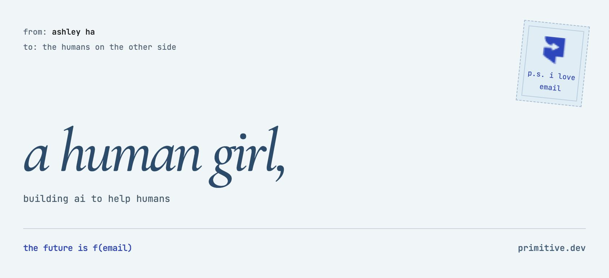

[](https://primitive.dev)

## a note from me

hi, i'm ashley. i'm building at [Primitive](https://primitive.dev), where agents get an email address & a way to connect

here for thoughtful tools, human connection & things made with care

[my projects](https://github.com/ashley-ha?tab=repositories) · [what we're building](https://primitive.dev)

₊✩‧₊˚౨ৎ˚₊✩‧₊

## a little invitation

good things begin with a hello, from you or your agent

<details>
<summary><picture><source srcset="https://raw.githubusercontent.com/ashley-ha/ashley-ha/main/assets/letterbox.png"></picture></summary>

hey, i'm ashley. building ai to help humans & always curious about what you're making

[**email me ♡**](mailto:yesreply@loud-olive.primitive.email?subject=hello%20ashley)

`yesreply@corp.primitive.dev`

<details>
<summary>have your agent say hello</summary>

give your agent a tiny introduction to pass along:

```text
Email Ashley at yesreply@corp.primitive.dev.
Introduce yourself, say who you are helping,
and share the idea or question we would like to discuss.
```

</details>

p.s. humans & agents welcome

</details>

&nbsp;

<div align="center">

. &nbsp;&nbsp;&nbsp; ˚ &nbsp;&nbsp;&nbsp;&nbsp;&nbsp; · &nbsp;&nbsp;&nbsp;&nbsp;&nbsp;&nbsp; ˚ &nbsp;&nbsp;&nbsp;&nbsp;&nbsp; . &nbsp;&nbsp;&nbsp;&nbsp;&nbsp;&nbsp; 🌻 &nbsp;&nbsp;&nbsp;&nbsp;&nbsp;&nbsp; . &nbsp;&nbsp;&nbsp;&nbsp;&nbsp; ˚ &nbsp;&nbsp;&nbsp;&nbsp;&nbsp;&nbsp; · &nbsp;&nbsp;&nbsp;&nbsp;&nbsp; ˚ &nbsp;&nbsp;&nbsp; .

</div>

&nbsp;

<table align="center">
<tr>
<td align="center" width="500">

### ˚₊‧ currently... ‧₊˚

`building` ~ ai to help humans advance

`listening` ~ rivendell ambiance ✦ cyberpunk ✦ lofi

`loving` ~ books, board games, & building fun things 

`reading` ~ tolkien ✦ sci fi ✦ fantasy

</td>
<td align="center" width="500">

<details>
<summary>&nbsp; ₊˚⊹ <b>previous lives</b> ⊹˚₊ &nbsp; <i>(click me~)</i></summary>

<br/>

| | |
|---|---|
| 𓀤 | national champion gymnast |
| ᯓ ✈︎ | flight attendant |
| [+..••] | semi pro gamer |

*every chapter led here* ₍ᐢ. .ᐢ₎

</details>

</td>
</tr>
</table>

&nbsp;

<div align="center">

. &nbsp;&nbsp;&nbsp; ˚ &nbsp;&nbsp;&nbsp;&nbsp;&nbsp; · &nbsp;&nbsp;&nbsp;&nbsp;&nbsp;&nbsp; ˚ &nbsp;&nbsp;&nbsp;&nbsp;&nbsp; . &nbsp;&nbsp;&nbsp;&nbsp;&nbsp;&nbsp; 🌻 &nbsp;&nbsp;&nbsp;&nbsp;&nbsp;&nbsp; . &nbsp;&nbsp;&nbsp;&nbsp;&nbsp; ˚ &nbsp;&nbsp;&nbsp;&nbsp;&nbsp;&nbsp; · &nbsp;&nbsp;&nbsp;&nbsp;&nbsp; ˚ &nbsp;&nbsp;&nbsp; .

</div>

&nbsp;

<div align="center">

### °+· main project ·+°

[**primitive.dev**](https://primitive.dev)

</div>

&nbsp;

<div align="center">

. &nbsp;&nbsp;&nbsp; ˚ &nbsp;&nbsp;&nbsp;&nbsp;&nbsp; · &nbsp;&nbsp;&nbsp;&nbsp;&nbsp;&nbsp; ˚ &nbsp;&nbsp;&nbsp;&nbsp;&nbsp; . &nbsp;&nbsp;&nbsp;&nbsp;&nbsp;&nbsp; 🌻 &nbsp;&nbsp;&nbsp;&nbsp;&nbsp;&nbsp; . &nbsp;&nbsp;&nbsp;&nbsp;&nbsp; ˚ &nbsp;&nbsp;&nbsp;&nbsp;&nbsp;&nbsp; · &nbsp;&nbsp;&nbsp;&nbsp;&nbsp; ˚ &nbsp;&nbsp;&nbsp; .

</div>

&nbsp;

<div align="center">

### °+· recently shipped ·+°

</div>

<table align="center">
<tr>
<td align="center" width="500">

[**Forever Agent**](https://chromewebstore.google.com/detail/ever/codfpjgkcdackkjhjhfefmfbckijjjnf)

Live Chrome Web Store extension for Ever — a browser agent that lives natively inside Chrome

</td>
<td align="center" width="500">

[**ralph-to-ralph**](https://github.com/namuh-eng/ralph-to-ralph)

Autonomous product cloning loop — give it any URL, it inspects, builds, tests, and deploys a working clone

</td>
</tr>
<tr>
<td align="center" width="500">

[**OpenSend**](https://github.com/namuh-eng/opensend)

Open source Resend alternative — emails, domains, broadcasts, and sending infra in one self-hostable product

</td>
<td align="center" width="500">

[**OpenDocs**](https://github.com/namuh-eng/opendocs)

Open source Mintlify clone — fast documentation sites with modern docs tooling

</td>
</tr>
<tr>
<td align="center" width="500">

[**Exponential**](https://github.com/namuh-eng/exponential)

Open source Linear and Jira alternative — issue tracking, projects, and self-hosted product workflow

</td>
<td align="center" width="500">

[**OpenGitHub**](https://github.com/namuh-eng/opengithub)

GitHub alternative being built through ralph-to-ralph as another product-cloning benchmark

</td>
</tr>
<tr>
<td align="center" width="500">

[**OpenBrand**](https://github.com/namuh-eng/openbrand)

Open source Brandfetch alternative for brand assets and company identity data

</td>
<td align="center" width="500">

[**EverBrowser**](https://github.com/namuh-eng/everbrowser)

Community-shared skill recipes for the Ever CLI and browser-agent workflows

</td>
</tr>
</table>

&nbsp;

<div align="center">

. &nbsp;&nbsp;&nbsp; ˚ &nbsp;&nbsp;&nbsp;&nbsp;&nbsp; · &nbsp;&nbsp;&nbsp;&nbsp;&nbsp;&nbsp; ˚ &nbsp;&nbsp;&nbsp;&nbsp;&nbsp; . &nbsp;&nbsp;&nbsp;&nbsp;&nbsp;&nbsp; 🌻 &nbsp;&nbsp;&nbsp;&nbsp;&nbsp;&nbsp; . &nbsp;&nbsp;&nbsp;&nbsp;&nbsp; ˚ &nbsp;&nbsp;&nbsp;&nbsp;&nbsp;&nbsp; · &nbsp;&nbsp;&nbsp;&nbsp;&nbsp; ˚ &nbsp;&nbsp;&nbsp; .

</div>

&nbsp;

<div align="center">

### °+· reach me ·+°

[](https://www.linkedin.com/in/ashleyha/)
&nbsp;&nbsp;
[](https://x.com/ashleybchae)
&nbsp;&nbsp;
[](https://instagram.com/ashleybchae)
&nbsp;&nbsp;
[](https://buymeacoffee.com/ashleyha)

</div>

&nbsp;

<div align="center">

. &nbsp;&nbsp;&nbsp; ˚ &nbsp;&nbsp;&nbsp;&nbsp;&nbsp; · &nbsp;&nbsp;&nbsp;&nbsp;&nbsp;&nbsp; ˚ &nbsp;&nbsp;&nbsp;&nbsp;&nbsp; . &nbsp;&nbsp;&nbsp;&nbsp;&nbsp;&nbsp; 🌻 &nbsp;&nbsp;&nbsp;&nbsp;&nbsp;&nbsp; . &nbsp;&nbsp;&nbsp;&nbsp;&nbsp; ˚ &nbsp;&nbsp;&nbsp;&nbsp;&nbsp;&nbsp; · &nbsp;&nbsp;&nbsp;&nbsp;&nbsp; ˚ &nbsp;&nbsp;&nbsp; .

</div>

&nbsp;

<div align="center">

```
$ git log --oneline --ashley
f1b8e3a init: human girl, building ai
e7f2a1b feat: believe in something bigger than ourselves

$ ashley --status
✦ compiling...
✦ building the future...
✦ build successful ♡
```


₊✩‧₊˚౨ৎ˚₊✩‧₊

<br/>

[](https://github.com/ashley-ha/ashley-ha/issues/1)
&nbsp;&nbsp;


</div>
